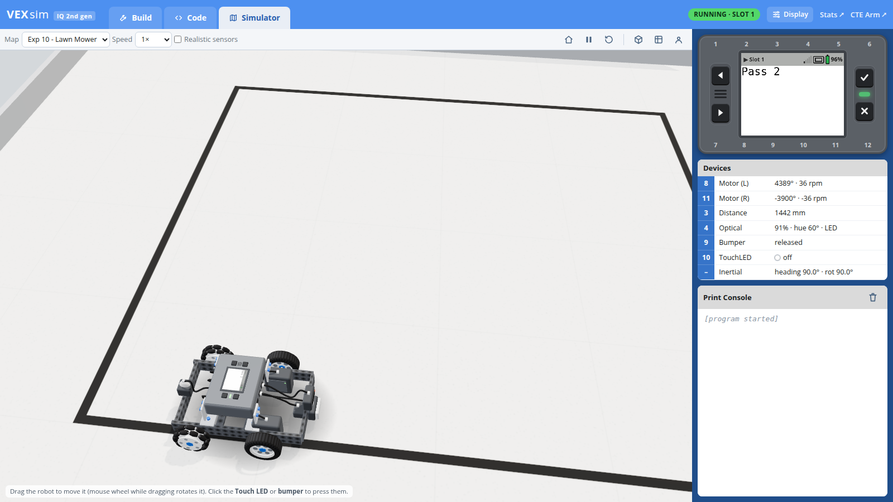
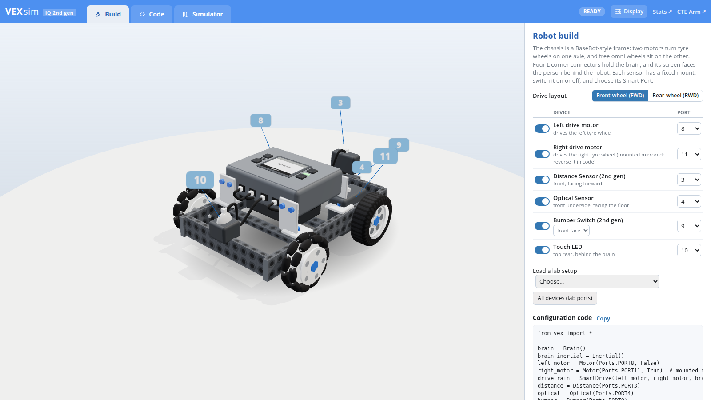
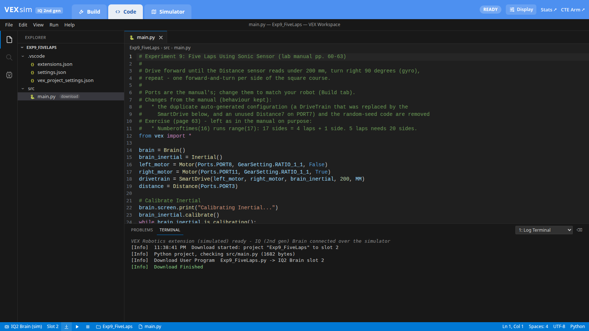
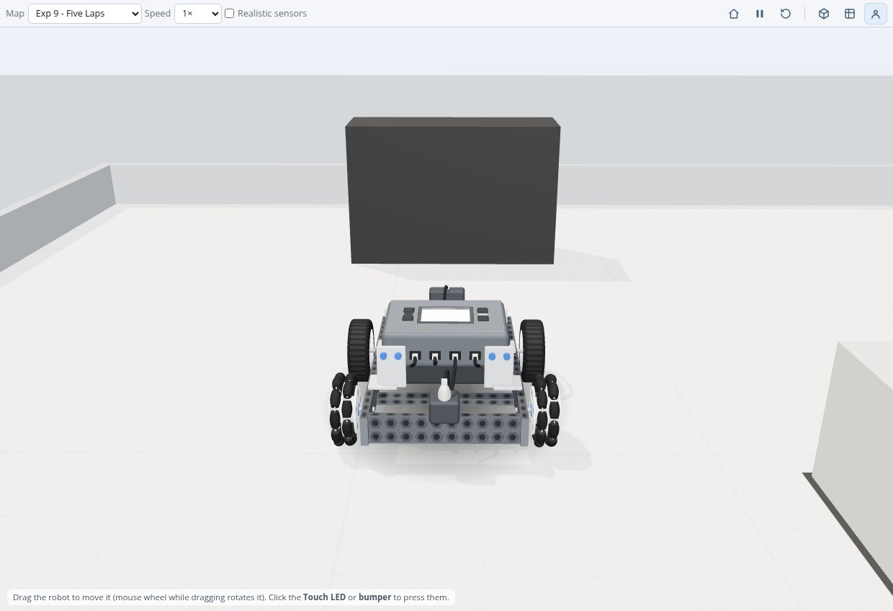
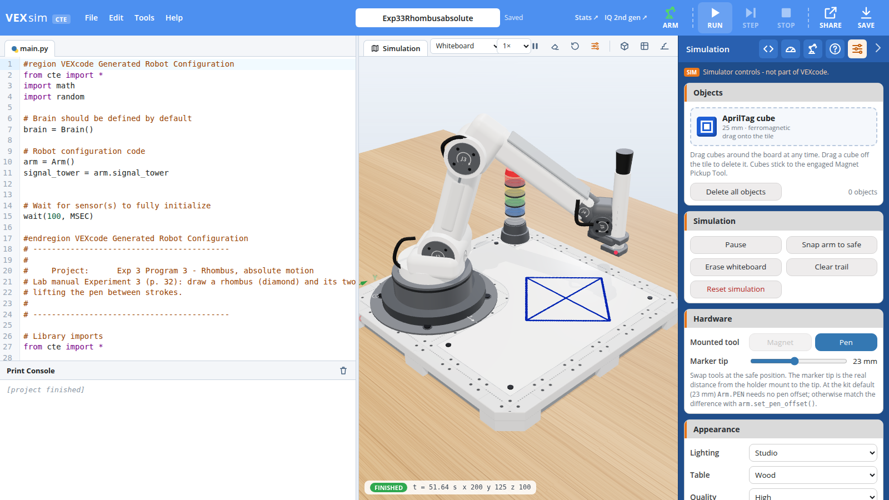
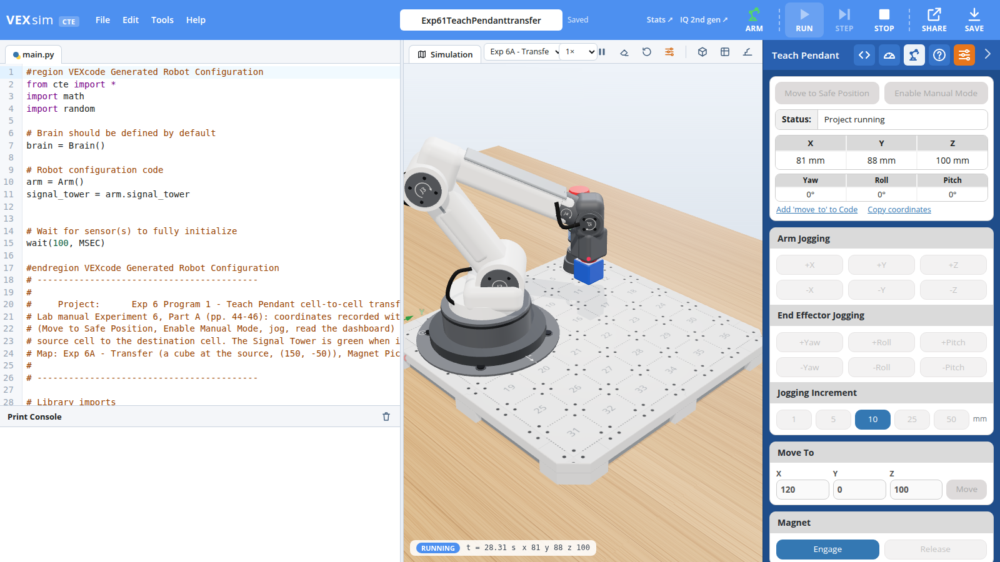
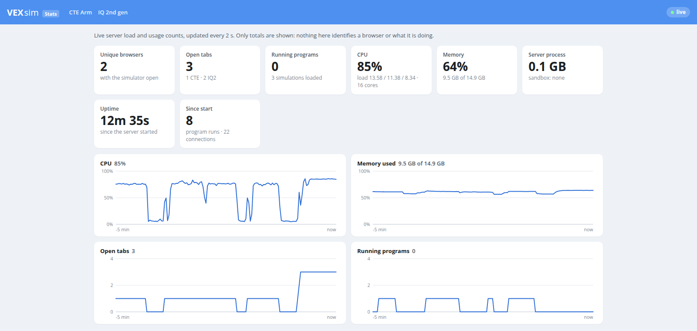
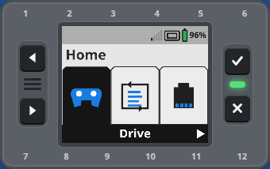
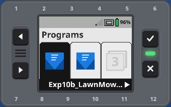
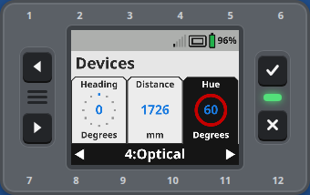

# VEX Simulator

**Practise VEX robotics in a web browser, with the same Python you'd run on the real robot.**

VEX Simulator is a free, open-source simulator for two classroom robots:

- **VEX IQ (2nd gen):** a BaseBot-style mobile robot with drive motors and Distance, Optical, Bumper and Touch LED sensors.
- **VEX CTE 6-Axis Arm:** the CTE Workcell arm with its Signal Tower, magnet and pen tools.

Students write VEXcode-compatible Python (`from vex import *`), press Run and watch a 3D robot carry it out. It's meant for practising lab experiments before (or without) the hardware, and for trying ideas safely.



> **Disclaimer.** This is an independent, unofficial educational project. It is **not** made, endorsed or supported by VEX Robotics or Innovation First International. VEX, VEX IQ, VEX CTE, VEXcode and related names are trademarks of their respective owners. Visual Studio Code is a trademark of Microsoft. No VEX artwork or logos are used: the 3D models, icons and screens are this project's own approximations, built from VEX's public documentation. Behaviour is simulated and may differ from real hardware. Always check against the [official documentation](#official-vex-documentation-and-products).

---

## Contents
- [What you can do](#what-you-can-do)
- [Screenshots](#screenshots)
- [Getting started](#getting-started)
- [Hosting it for a class](#hosting-it-for-a-class)
- [Official VEX documentation and products](#official-vex-documentation-and-products)
- [How it's built](#how-its-built)
- [License](#license)

## What you can do

### VEX IQ (2nd gen): `/vex_cte/iq2/`
The IQ app has three tabs.

| Tab | What it does |
|---|---|
| **Build** | Look at the robot in 3D. Choose front-wheel (FWD) or rear-wheel (RWD) drive. Plug each device into any Smart Port or unplug it, and mount the bumper on the front or the back. One click applies a lab setup, and the page shows the matching configuration code. |
| **Code** | A Visual Studio Code look-alike with the VEX extension. Create a project (IQ 2nd gen, Python, templates), edit it, download it to a brain slot (1–8) and press Play. A log terminal, an interactive terminal and a problems panel show what happened. |
| **Simulator** | Run your program on a map: a blank mat, or the lab-experiment courses. All maps have walls. The brain's buttons and menus work like the real 160×128 light-theme screen (Home, Programs, Devices, Settings). Drag the robot around, and press its Touch LED or bumper with the mouse. |

**Sensors:** realistic by default, with seeded noise, gyro drift, slightly curving straight lines, and encoder turns that over-rotate like real robots do. An **ideal** switch gives exact, repeatable readings instead.

**Display:** the **Display** menu sets quality (Low, Medium or High), lighting and shadows. At High quality the robot also shows its Smart cables.

### VEX CTE 6-Axis Arm: `/vex_cte/`
- **Interface:** a VEXcode-style editor with a Teach Pendant: Move to Safe Position, Manual Mode (drag the arm with the mouse), jogging, Move To, and magnet controls.
- **Workspace:** a CTE Tile with AprilTag cubes that fall under gravity and can be stacked, plus a whiteboard you can draw on with the Pen Holder Tool.
- **Python API:** the Arm API (`move_to`, `move_inc`, end-effector moves, speed, reach checks, callbacks) and the Signal Tower.

### Lab programs
Both apps include programs from a university *Introduction to Robotics* lab manual, under **Lab Programs**. Each one sets up its own map and devices.

| App | Experiments |
|---|---|
| IQ | Exp 7 Sensor Bed, Exp 8 Line Runner, Exp 9 Five Laps, Exp 10 Lawn Mower, plus Exp 10b, the lawn mower as the manual's diagram shows it |
| CTE | Exp 3 (polygon and rhombus drawing), Exp 4 (palletizing), Exp 6 (Teach Pendant transfer and obstacle avoidance) |

[docs/specs/iq2_labs.md](docs/specs/iq2_labs.md) and [docs/specs/cte_labs.md](docs/specs/cte_labs.md) list the experiments, their maps, and the bugs found in the manual's code.

### Server statistics: `/vex_cte/stats/`
A public page with live CPU and memory use and usage counts: browsers, tabs, running programs. It shows totals only and never identifies anyone.

## Screenshots

All shots use High quality. The IQ robot is wired: left motor 8, right motor 11, Distance 3, Optical 4, Bumper 9, Touch LED 10.

| | |
|---|---|
|  |  |
| **IQ Build tab:** fixed chassis, devices and ports, Smart cables | **IQ Code tab:** a VS Code look-alike with the VEX extension, after a download to slot 2 |
|  |  |
| **IQ Simulator, follow camera:** Exp 9 on the five-laps course | **CTE arm:** Exp 3 drew a rhombus and its diagonals on the whiteboard |
|  |  |
| **CTE arm:** Exp 6 carries a cube, with the Teach Pendant showing live coordinates | **Server statistics:** load and usage counts only |

The brain's own interface: Home, Programs (two downloaded projects) and the live Devices view.

  

## Getting started

You need [Python 3.12+ with uv](https://docs.astral.sh/uv/) and [Node.js](https://nodejs.org/) 18+.

```bash
uv sync                                       # backend dependencies
(cd frontend && npm install && npm run build) # build the web pages
uv run vexsim serve                           # then open http://127.0.0.1:8000/vex_cte/
```

The IQ app is at `/vex_cte/iq2/` and the stats page at `/vex_cte/stats/`. Each page links to the others.

**Developing the frontend with hot reload:** run `uv run vexsim serve` in one terminal and `cd frontend && npm run dev` in another, then open http://localhost:5173/vex_cte/.

**Running a program without a browser** (for tests or marking):

```bash
uv run vexsim run backend/vexsim/examples/cte/pick_place.py --scenario cte_tile
uv run vexsim run backend/vexsim/examples/iq2/labs/exp09_five_laps.py --platform iq2 --scenario five_laps
uv run vexsim run my_program.py --platform iq2 --scenario blank --json
uv run pytest                                 # the test suite
```

## Hosting it for a class

Everything is served under one path, `/vex_cte/` by default (`--base-path` or `VEXSIM_BASE_PATH` changes it). The pages only use relative URLs, so a reverse proxy can put any prefix in front.

- [`deploy/nginx-vexsim.conf`](deploy/nginx-vexsim.conf) has the nginx `location` blocks, including WebSocket upgrades.
- [`deploy/vexsim.service`](deploy/vexsim.service) is a hardened systemd unit; [`deploy/vexsim-user.service`](deploy/vexsim-user.service) runs it next to rootless Docker or Podman.

> ⚠️ **The simulator runs the Python that users type on the server.** On a shared server, turn on the sandbox (`vexsim serve --sandbox docker`). Each session's code then runs in its own throw-away container with no network, a read-only filesystem, no capabilities, an unprivileged user, and CPU, memory and process limits. See [docs/sandbox.md](docs/sandbox.md). Limiting who can reach the server (LAN only and/or a password in nginx) is still a good idea.

To update a server: pull, run `npm run build` in `frontend`, run `uv run vexsim sandbox build` if you use the sandbox, and restart the service.

## Official VEX documentation and products

This project follows VEX's public documentation. For anything that matters, use the real thing.

**VEX IQ (2nd gen)**
- Product line: [VEX IQ](https://www.vexrobotics.com/iq) and the [IQ Robot Brain (2nd gen)](https://www.vexrobotics.com/228-6480.html).
- [IQ (2nd gen) Python API reference](https://api.vex.com/iq2/home/python/index.html).
- Brain screen and menus: the [Guide to the VEX IQ Brain Screen (2nd gen)](https://kb.vex.com/hc/en-us/articles/13595260156820-Guide-to-the-VEX-IQ-Brain-Screen-2nd-gen) and [Navigating Menus](https://kb.vex.com/hc/en-us/articles/4407024174996-Navigating-Menus-IQ-Brain-2nd-gen).
- Sensors and parts: [Distance Sensor (2nd gen)](https://kb.vex.com/hc/en-us/articles/4407296307348-Using-the-IQ-Distance-Sensor-2nd-gen), [IQ wheels](https://kb.vex.com/hc/en-us/articles/360035955171-Understanding-VEX-IQ-Wheels), [Smart Motor performance](https://kb.vex.com/hc/en-us/articles/18113746616724-Understanding-IQ-Smart-Motor-Performance), and [1st vs 2nd gen](https://kb.vex.com/hc/en-us/articles/7267344764308-Understanding-IQ-1st-Generation-vs-2nd-Generation).

**VEX CTE**
- [Overview of the CTE Workcell Kit](https://kb.vex.com/hc/en-us/articles/27339074776980-Overview-of-the-CTE-Workcell-Kit).
- API reference: [CTE 6-Axis Arm Python API](https://api.vex.com/cte/home/python/Arm.html) and [Signal Tower](https://api.vex.com/cte/home/python/SignalTower.html).
- [Troubleshooting the CTE 6-Axis Arm](https://kb.vex.com/hc/en-us/articles/32138274956308-Troubleshooting-the-CTE-6-Axis-Arm).

**Coding tools and learning**
- [VEXcode](https://www.vexrobotics.com/vexcode), VEX's official coding environments.
- [VEX VS Code extension](https://marketplace.visualstudio.com/items?itemName=VEXRobotics.vexcode). Its guides: [UI overview (IQ)](https://kb.vex.com/hc/en-us/articles/8604273158164) and [new IQ project](https://kb.vex.com/hc/en-us/articles/8604236587028).
- [VEX Library (knowledge base)](https://kb.vex.com/) and [VEX STEM Labs](https://education.vex.com/).

Every source used, and how confident each number is (REAL, MEASURED or ESTIMATE), is listed in [docs/research/sources.md](docs/research/sources.md) and [docs/specs/](docs/specs/).

## How it's built

- **Backend:** a Python FastAPI server gives each browser tab its own simulation worker. The worker runs the student's Python against a fixed-step, kinematic simulation and streams the state to the browser about 30 times a second.
- **Frontend:** TypeScript, [three.js](https://threejs.org/) and [CodeMirror](https://codemirror.net/).

```
backend/vexsim/
  core/        sim clock, fixed-step loop, world, transforms, config
  robots/      physical models: cte_arm/ (kinematics, tools, cubes) and iq2/ (drive, sensors, brain, field)
  api/         the student-facing `vex` module: common/, cte/, iq2/
  runner/      the worker process and its JSON-lines protocol
  server/      FastAPI: REST, WebSocket sessions, sandbox, statistics
  scenarios/   maps (YAML)
  examples/    example and lab programs (File ▸ Load Example / Lab Programs)
frontend/      the CTE page (index.html), iq2/, stats/
docs/          architecture, sandbox, spec sheets, images
tests/         pytest suite
```

Start with [docs/README.md](docs/README.md), the documentation guide. [docs/architecture.md](docs/architecture.md) explains how the pieces talk to each other and how to add a robot.

## License

[GNU GPL v3](LICENSE). See the [disclaimer](#vex-simulator) at the top: this is not an official VEX product.
