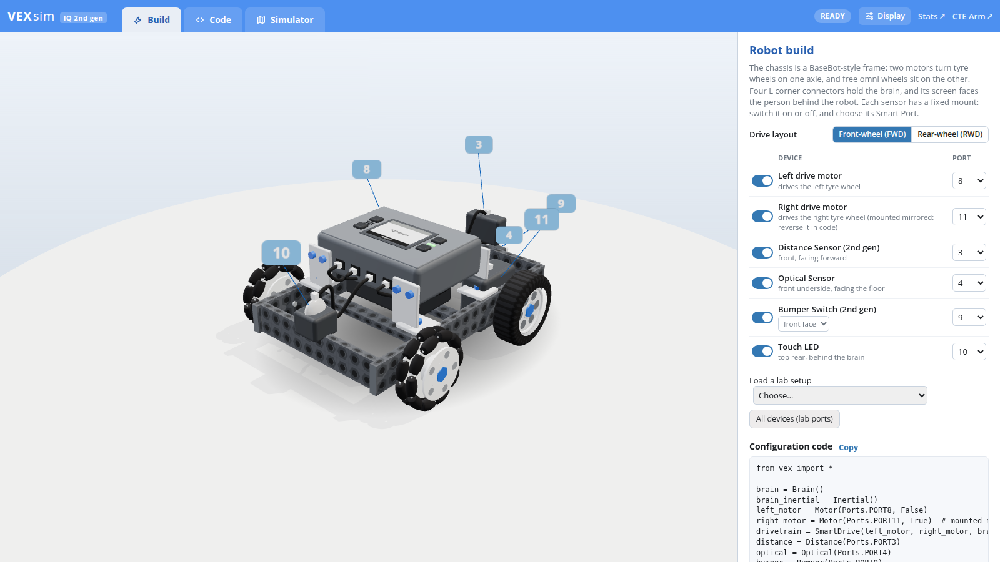
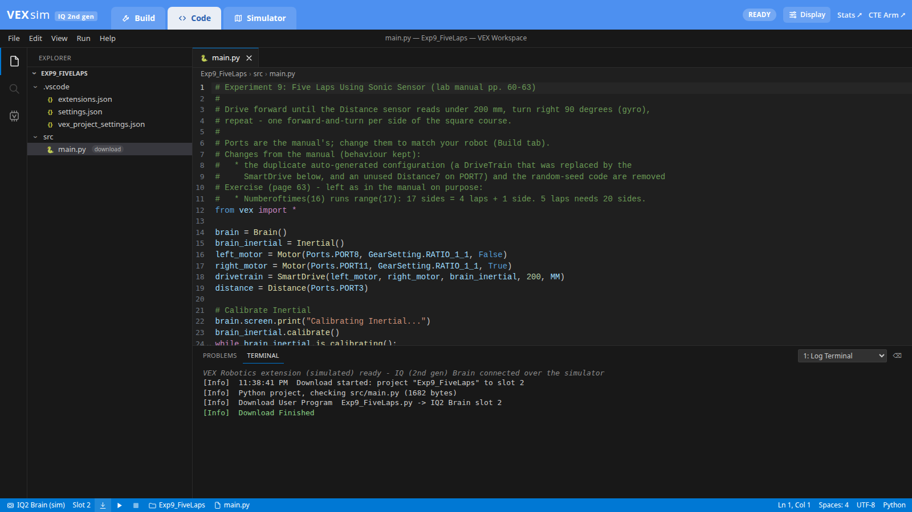
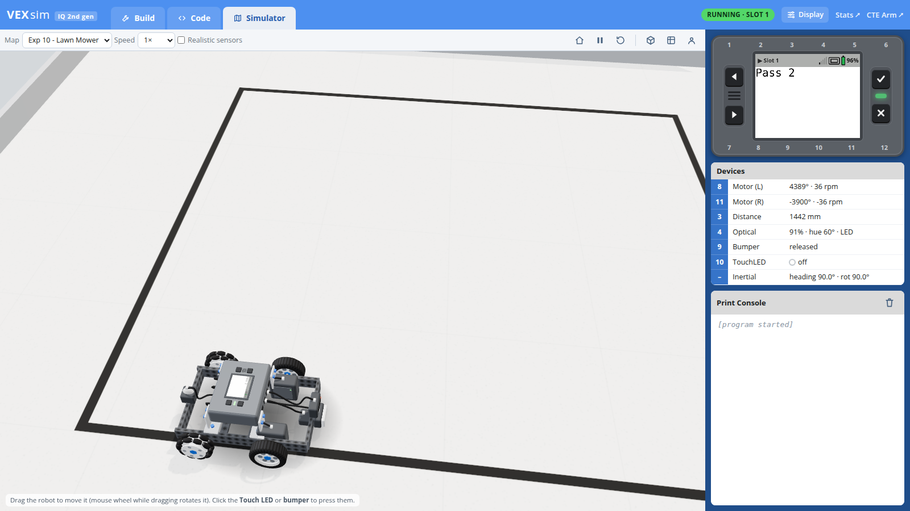
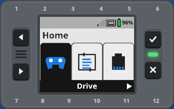
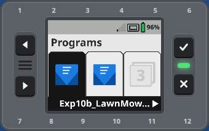
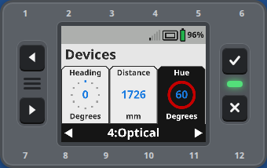
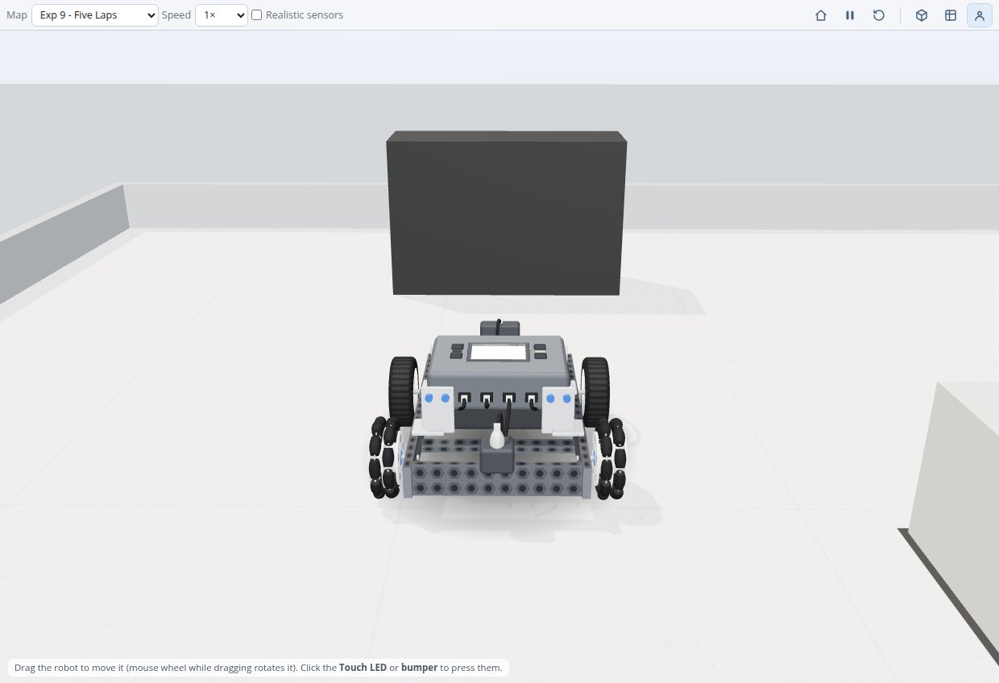
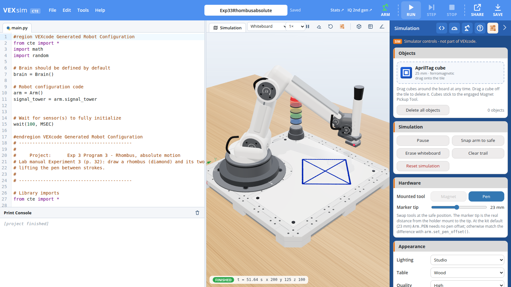
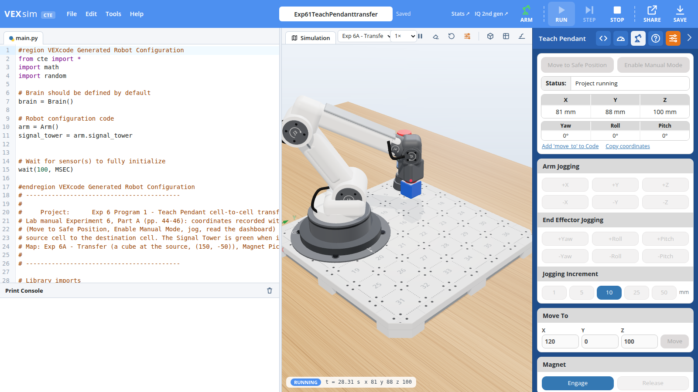
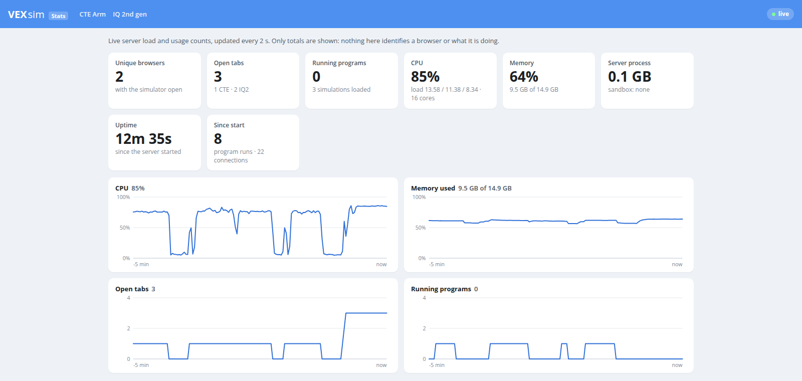

# VEX Simulator documentation

These pages explain how the simulator behaves, why, and where each number comes from. They're written for teachers and students who want to know how close the simulator is to the real robots, and for anyone changing the code.

> VEX Simulator is an independent, unofficial project. It is not made, endorsed or supported by VEX Robotics. For the real products and their official documentation, see the [links in the main README](../README.md#official-vex-documentation-and-products).

## Start here

| Page | What it covers |
|---|---|
| [architecture.md](architecture.md) | How the browser, server and simulation worker talk to each other; time, determinism and adding a robot |
| [sandbox.md](sandbox.md) | Running students' code safely on a shared server (rootless Docker / Podman) |
| [research/sources.md](research/sources.md) | Every official page and community source used |

## Spec sheets: what is simulated, and how sure we are

Every number in the spec sheets is tagged:
- **REAL**: from an official VEX source.
- **MEASURED**: a community or lab measurement.
- **ESTIMATE**: a sensible guess, tunable in the robot's `geometry.yaml`.

**VEX IQ (2nd gen)**

| Page | What it covers |
|---|---|
| [specs/iq2_api.md](specs/iq2_api.md) | The Python API as simulated: Motor, DriveTrain/SmartDrive, sensors, Brain, screen |
| [specs/iq2_hardware.md](specs/iq2_hardware.md) | Robot geometry, FWD/RWD, motors, sensor models, realistic vs ideal mode |
| [specs/iq2_brain_ui.md](specs/iq2_brain_ui.md) | The brain's buttons and menus, and the VS Code + VEX extension look-alike |
| [specs/iq2_labs.md](specs/iq2_labs.md) | Lab experiments 7–10 and 10b: maps, device presets, bugs found in the manual's code |

**VEX CTE 6-Axis Arm**

| Page | What it covers |
|---|---|
| [specs/cte_arm_api.md](specs/cte_arm_api.md) | The Arm Python API as simulated |
| [specs/cte_hardware.md](specs/cte_hardware.md) | Arm, Tile and cube geometry; kinematics limits |
| [specs/cte_signal_tower.md](specs/cte_signal_tower.md) | The Signal Tower |
| [specs/brain_runtime.md](specs/brain_runtime.md) | Program structure (`cte_thread`), console, timers, threads |
| [specs/teach_pendant_and_ide.md](specs/teach_pendant_and_ide.md) | The VEXcode-style IDE and Teach Pendant behaviour |
| [specs/cte_labs.md](specs/cte_labs.md) | Lab experiments 3, 4 and 6 |

## A tour in pictures

### IQ (2nd gen)

**Code tab:** create a project, download it to a slot, press Play.

**Simulator tab:** the brain panel works like the real brain. Its Devices view shows live readings.

  

**Follow camera:** watch from behind the robot and read its screen.

### CTE 6-Axis Arm

### CTE: what's simulated

| Area | Status |
|---|---|
| Arm API: `move_to`/`inc`, `move_end_effector_to`/`inc`, speed, timeout, control stop, `can_*_reach`, getters, callbacks | ✅ Matches api.vex.com signatures |
| Kinematics | Analytic 6-DOF IK/FK, joint limits, floor and base keep-out, about 330 mm reach |
| Motion | Straight-line Cartesian moves with trapezoidal speed profile, joint-space fallback, joint-speed limits |
| Magnet tool | Picks the cube under the tool, carries it, and drops it onto the Tile or a stack. Crash detection |
| Pen tool | `set_pen_offset`. Draws on the Tile when the tip touches z = 0 |
| Signal Tower | `set_color`, `set_colors`, ON/OFF/BLINK, clickable bumper with `pressed`/`released`/`pressing` |
| Runtime | `wait`, `Brain` timer (`timer_time`, `timer_reset`, `timer_event`), `Thread`, `Event`, `print`, `brain.program_stop` |
| UI | VEXcode-style IDE: blue toolbar (ARM / RUN / STEP / STOP / SHARE / SAVE), File/Edit/Tools/Help menus, project name + autosave, Python editor + Print Console, 3D simulation pane, collapsible side panel |
| Teach Pendant | Move to Safe Position (unlocks pendant), Enable Manual Mode (**drag the arm with the mouse**, Shift = up/down), status bar, X/Y/Z dashboard, arm + end-effector jogging, increments, Move To, Magnet engage/release, units mm/in, speed, end effector, pen offset, "Add move_to to code" |
| Monitor / Help | Live device values, Signal Tower with clickable bumper; Python quick reference |
| Maps | **CTE Tile** (3 cubes) and **Whiteboard** (Dry-Erase Surface), plus the lab-manual maps for Exp 4 and Exp 6. A map only changes the base: the mounted tool is kept across map changes and resets. Examples are in File ▸ Load Example, and the lab-manual programs (Exp 3, 4 and 6; see [specs/cte_labs.md](specs/cte_labs.md)) are in File ▸ Lab Programs |
| Persistent scene | Arm pose, mounted tool, cubes, drawings and tower LEDs survive Run / Stop / Manual Mode. Each Run resets VEX's per-project defaults (speed 50 %, MAGNET, pen offset 0, magnet off), then **homes to the safe position** before the code starts |
| Safe-position rules | Manual Mode and end-effector swaps are only allowed at the safe position (120, 0, 100) |
| Manual Mode | Motors power down: like the real arm, the links **slowly sink and settle** (overdamped gearbox back-drive: J2 leans back, the elbow folds to its mechanical stop just short of the shoulder housing, and the arm settles on its stops). The tool, wrist and forearm collide with cubes, so you can rest the tool on a cube top. Drag it by the tool tip; **keep tool vertical** (V, default on with the pen) holds the tool perpendicular to the board. **C** copies the tip x, y, z, **M** inserts `arm.move_to(x, y, z)` into the code - also while holding the arm |
| Tools | Mounted tool (physical) is separate from the configured end effector (code). IK targets the configured tip; the real tip (magnet face / marker tip, offset 22 mm sideways in its C-clamp) is what touches things. Hints are shown when they disagree |
| Cubes | Ferromagnetic 25 mm cubes (rounded edges) with blue-white tag36h11 AprilTags. They **fall under gravity** when released (magnet off, dropped by hand, support removed). Drag in from the Simulation panel, drag around (stacking), drag off the tile to delete, at any time |
| Pen | The marker only leaves ink on the whiteboard sheet - not on the bare Tile or off the Tile |
| Simulation panel (not VEXcode) | Object tray, delete all, pause, snap arm to safe, erase whiteboard, reset simulation, mounted tool + marker length, appearance (lighting, table, quality, arm/cube colours, overlays, shadows, trail, cables) |

Hardware numbers and their confidence (REAL / MEASURED / ESTIMATE) are in [specs/](specs/). Tune the arm in [`geometry.yaml`](../backend/vexsim/robots/cte_arm/geometry.yaml).

### Server statistics

The stats page (`/vex_cte/stats/`, data at `GET /vex_cte/api/stats`) shows counts only.
- Each browser sends a random id, which is only used to count distinct browsers.
- No id, IP address or per-tab detail is ever returned.
