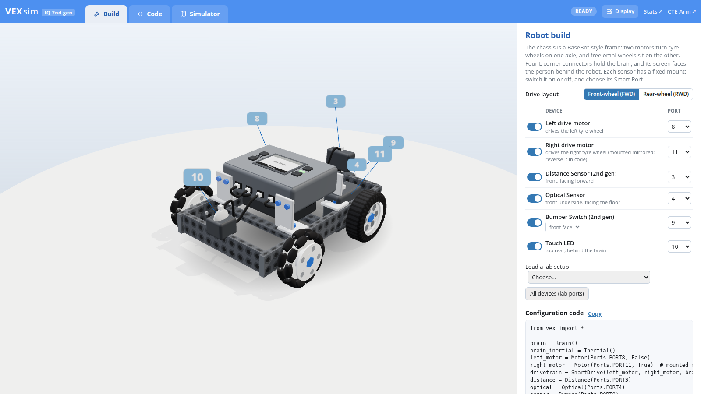

# Spec: VEX IQ (2nd gen) robot hardware (simulated BaseBot, front-wheel drive)

*The simulated robot: FWD layout, every device plugged in, Smart cables shown at High quality.*

Confidence tags:
- **REAL**: from an official VEX source.
- **LAB**: taken from the lab manual's VEXcode configuration.
- **ESTIMATE**: a guess. Tune it in `backend/vexsim/robots/iq2/geometry.yaml`.

Sources:
- [KB-D] https://kb.vex.com/hc/en-us/articles/4407296307348-Using-the-IQ-Distance-Sensor-2nd-gen
- [KB-W] https://kb.vex.com/hc/en-us/articles/360035955171-Understanding-VEX-IQ-Wheels
- [KB-G] https://kb.vex.com/hc/en-us/articles/7267344764308-Understanding-IQ-1st-Generation-vs-2nd-Generation
- [KB-M] https://kb.vex.com/hc/en-us/articles/18113746616724-Understanding-IQ-Smart-Motor-Performance
- [API] https://api.vex.com/iq2/home/python/ (Screen page: 160×108 px)
- [IMG] BaseBot render: https://kb.vex.com/hc/article_attachments/4463801454996
- [LAB] Lab manual, Exp 9/10: `DriveTrain(l, r, 200, 173, 76, MM, 1)`

vexrobotics.com product pages refuse automated fetches, so body dimensions are estimates.

## Layout (user decisions, 2026-11-24)

The robot is BaseBot-style, as in [IMG], but with front-wheel drive:
- **Drive:** two Smart Motors drive 200 mm travel tyre wheels at the front.
- **Rear wheels:** two free 200 mm omni wheels.
- **Brain mounting:** the brain and battery are held by four L corner connectors with blue pins. The connectors sit on the long edges of the brain and stand on the side rails.
- **Screen orientation:** the screen's "up" points forward, so it reads upright for a person standing behind the robot.
- **Sensors:** each has a fixed mount, can be switched ON or OFF, and has an editable Smart Port. Port defaults come from the lab manual.

| Device | Mount | Default port |
|---|---|---|
| Left drive motor | front left | 6 (LAB) |
| Right drive motor | front right, mounted mirrored, so code must reverse it | 1 (LAB) |
| Distance (2nd gen) | front, facing forward, sensing point 62 mm high | 5 (LAB) |
| Optical | front underside, facing the floor, 10 mm above it | 3 (LAB; Exp 8 uses 7) |
| Bumper (2nd gen) | front face, or the back face (Build tab, `bumper.mount: front \| rear`) | 11 (LAB) |
| Touch LED | top rear, behind the brain | 4 (LAB) |
| Inertial | built into the brain | – |

## Drive layout: FWD or RWD (Build tab)
- **FWD** (default): motors and tyres on the front axle, omni wheels at the rear. **RWD**: swapped.
- `geometry.yaml` describes the chassis in its FWD layout (drive axle at chassis x = 0). The robot's pose is always the centre of the **driven** axle, which is the point a two-wheel drive turns about.
- With RWD the chassis, sensors and bumper sit one wheelbase (127 mm) ahead of the pose. So the robot pivots about its rear axle, and the front sensors swing through a wider arc when it turns.
- Map starts give the chassis position. Switching the layout keeps the chassis where it is on the mat.
- The config key is `drive: "fwd" | "rwd"`, sent with `robot_config`. Lab presets keep the current layout.

## Frame and drive

The robot frame has its origin at the drive-axle centre on the floor. +x points forward, +y points left, and +z points up. The pose is this point, and a differential drive turns about it.

| Item | Value | Tag |
|---|---|---|
| Grid pitch | 12.7 mm (0.5 in) | REAL |
| Wheel travel | 200 mm per revolution (Ø 63.7 mm), same for tyres and omnis | REAL [KB-W] |
| Track width | 173 mm | LAB |
| Wheelbase (drive axle to omni axle) | 127 mm (10 pitch). The lab config says 76, but the API doesn't use it | ESTIMATE |
| Collision footprint | x from −165 to +85 mm, y ±97 mm. A back-mounted bumper extends the rear by 22 mm | ESTIMATE |
| Brain body | 86 × 111 × 33 mm, long edge across the robot | ESTIMATE |
| Battery | 7.2 V, 2000 mAh, Li-ion, under the brain | REAL [KB-G] / position ESTIMATE |

## Smart Motor

| Item | Value | Tag |
|---|---|---|
| Free speed | 120 rpm (100 % = 120 rpm = 720 dps) | REAL [KB-M] |
| Stall torque | 0.414 N·m | REAL [KB-M] |
| Current | 0 to 1.2 A (API range) | REAL |
| Spin-up rate | 800 rpm/s | ESTIMATE |
| BRAKE / HOLD deceleration | 2400 rpm/s | ESTIMATE |
| COAST deceleration | 300 rpm/s | ESTIMATE |

When the robot is pushing against an obstacle, the wheels **stall**: the encoders stop and the current rises to the max-torque limit. A `spin_for` or `drive_for` that is blocked never finishes unless a timeout is set, just as on the real robot.

## Sensors

| Sensor | Model | Tag |
|---|---|---|
| Distance | Range 20 to 2000 mm. "Object detected" below 1000 mm. With nothing in range it returns 9999 mm | REAL / 9999 ESTIMATE (V5 behaviour) |
| | Error is ±15 mm below 200 mm and 5 % above (realistic mode only) | REAL [KB-D] |
| | Narrow beam: centre ray plus rays at ±6°. Obstacles lower than 62 mm are not seen | ESTIMATE |
| | Size is SMALL below 60 mm of visible width, MEDIUM below 150 mm, otherwise LARGE. Velocity is in m/s, positive when approaching | ESTIMATE |
| Optical | Averages the floor colour over a 6 mm spot | ESTIMATE |
| | Brightness = reflectance × (0.35 + 0.65 × LED %), as a percentage | ESTIMATE |
| | Reflectance: white 0.95 and black tape 0.08. So white reads 95 % and tape 8 % with the LED at 100 %. With the LED off, they read 33 % and 3 % | ESTIMATE, chosen to fit the manual's thresholds (white ≥ 80, black < 40) |
| | The LED is off at program start | ESTIMATE |
| Bumper | Pressed while the front plate touches an obstacle (within 2.5 mm), or when clicked in the UI | ESTIMATE |
| Touch LED | Pressed when clicked in the UI. `on()` without a colour uses the last colour, as the manual describes | – |
| Inertial | Heading 0 to 359.99 and rotation are clockwise-positive. `calibrate()` takes 2 s | REAL / 2 s ESTIMATE |
| | Realistic mode adds 0.01 °/s drift and 0.05° read noise | ESTIMATE |

## Realistic mode (default) vs ideal

The **Realistic sensors** switch is on by default in the browser. Headless runs and tests use ideal mode. Realistic mode is seeded, so a run can be repeated exactly. It adds the following.

- **Sensor noise and gyro drift**, as listed above.
- **Unguided straight driving:** each wheel's travel is off by up to ±0.4 %, so the robot curves by up to about 2.7° per metre.
  - This applies even with `SmartDrive`. The user confirmed that on the lab robots, driving straight is not gyro-guided and drifts.
  - The manual's 5° "corrective deviation" works for a couple of laps for this reason.
- **Encoder turns over-rotate:** a `DriveTrain` (encoder-only) turn has a gain of 1.06, so `turn_for(85)` turns about 90°. The user reports this on the lab robots.
- **SmartDrive turns** close the loop on the gyro, so they land on target. Turning is the only part the gyro guides.
