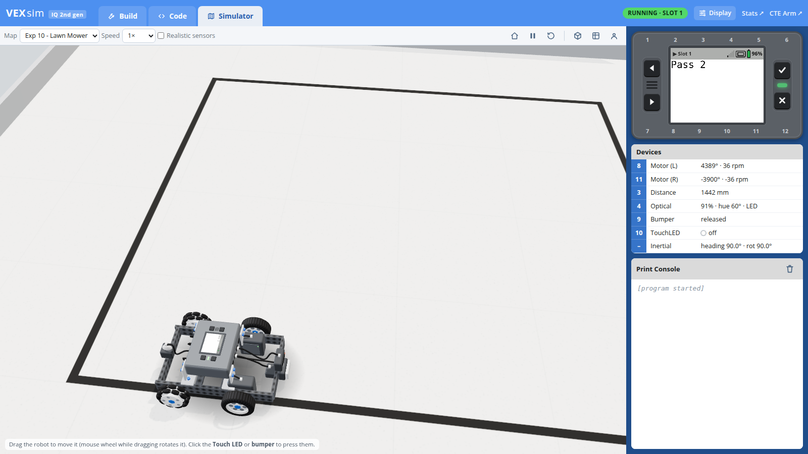

# Spec: lab-manual experiments (IQ 2nd gen)

*Exp 10b (the lawn mower as in the manual's diagram) part-way through its second pass.*

Sources (supplied by the user):
- `docs/research/Document 23.pdf`: lab manual pages 49–67.
- `docs/research/VEX_IQ_Example_Codes_crude.txt`: alternative versions. Not shipped; the CTE programs in it are ignored.

## Shipped programs

The shipped programs are in `backend/vexsim/examples/iq2/labs/` and listed in `examples/iq2/index.yaml`. Each one carries:
- `map`
- `robot` preset: the devices it uses and their ports. Every other device is switched OFF.
- `exam` flag

| Exp | File | Map | Devices (manual ports) | In exam |
|---|---|---|---|---|
| 7 Sensor Bed | `exp07_sensor_bed.py` | `sensor_bed` | motors L6 / R1, bumper 11, distance 5, optical 3, Touch LED 4 | yes |
| 8 Line Runner Challenge | `exp08_line_runner.py` | `line_runner` | motors L6 / R1, optical 7 | yes |
| 9 Five Laps (Distance) | `exp09_five_laps.py` | `five_laps` | motors L6 / R1, distance 5 | yes |
| 10 Robo Lawn Mower | `exp10_lawn_mower.py` | `lawn_mower` | motors L6 / R1, optical 3 | yes (other batch) |
| 10b Lawn Mower, as in the diagram | `exp10b_lawn_mower_diagram.py` | `lawn_mower` | motors L6 / R1, optical 3 | yes (other batch) |

Ports and thresholds differ between real robots and setups. The manual's values are only defaults.

## Edits to the manual's code (user-approved)
- **Right motor:** in Exp 7 and Exp 8 the right motor is reversed. The manual's `Motor(PORT1, ..., False)` is a typo that makes the robot spin in place.
- **Removed code that does nothing:** the unused random-seed code and imports, the unused Inertial in Exp 8 and Exp 10, Exp 9's duplicate config with its unused `Distance7`, and Exp 10's unused `convert_color_to_string`.
- **Repeated code folded into helpers:** Exp 7's repeated stop / LED / screen code into `report()`. Exp 8's three identical phase blocks into `return_to_start()`, with `lineCount == phase`.
- **Kept on purpose (exercise starting points):** Exp 9's `Numberoftimes(16)`, which runs 17 sides, and Exp 10's right-only turns.

## Bugs found in the manual's code (noted in each file's header)
1. **Exp 7 heading check:** `abs(heading()) > 90` uses heading, which runs 0 to 359.99. Drifting left gives about 359, and turning right at the line gives about 90 plus overshoot, so the check keeps triggering. `rotation()` with `reset_rotation()` was meant.
2. **Exp 7 distance branch:** it never turns away, so the robot stays stopped at the obstacle.
3. **Exp 7, 8 and 9 screen text:** `clear_screen()` does not reset the cursor (confirmed on the real brain), so text moves down and to the right, eventually off the screen. Add `set_cursor(1, 1)`.
4. **Exp 8 stops past the line:** it waits 400 ms before stopping, so it stops about 30 mm past each line. Also, the aim says "stop at the third line", but the code returns to the start.
5. **Exp 9 lap count:** `range(x + 1)` with 16 gives 17 sides, which is 4¼ laps. This is the exercise.
6. **Exp 10: the diagram and the code disagree.** The diagram shows back-and-forth mowing with 180° U-turns. The code follows the boundary with 85° right turns.
   - The code only works on a **rear-wheel-drive** robot. There the Optical sensor is a wheelbase plus 50 mm ahead of the turning axle, so after `drive_for(200 mm)` and the turn, it can still reach the next line.
     - Realistic mode, where `turn_for(85)` turns about 90° as on the lab robots: RWD completes the yard in about 6 of 8 runs, FWD in none.
     - On FWD the robot ends up outside the yard, beside the boundary, and stops at the mat wall.
   - **`exp10b_lawn_mower_diagram.py`** does what the diagram shows.
     - It mows a pass until the line, makes a U-turn (turn down the yard, move one row of 200 mm, turn back), and alternates right and left U-turns until the bottom line appears during a row change.
     - It turns to absolute gyro headings (0°, 90°, 180°), so the drift from unguided straight driving is cancelled at every U-turn instead of adding up.
     - It completes in both layouts and both modes: 6 passes on FWD, 5 on RWD.

## Maps (ESTIMATE sizes, from the manual's figures; edit `backend/vexsim/scenarios/iq2/*.yaml`)

Every map gets IQ-field-style perimeter walls just outside the mat: 75 mm high, 20 mm thick, ids `wall_n`, `wall_s`, `wall_e` and `wall_w`. Set `walls: false` in a map's YAML to turn them off.
- A robot that goes astray stops against the wall. The Simulator then shows a banner with "Put it back at the start".
- The walls are taller than the Distance sensor (62 mm), so it can see them.

All maps use 19 mm black tape (ESTIMATE). World frame: +x east, +y north, mm. Starts face +y unless noted.

| Map | Floor | Layout | Start |
|---|---|---|---|
| `blank` | 2.4 × 2.4 m | empty | (0, −600) |
| `sensor_bed` | 1.83 m square | a black line across y = 0, a red block at (700, 40), a blue can | (0, −600) |
| `line_runner` | 0.6 × 1.9 m lane outlined in tape, inside a 1.2 × 2.4 m floor | lines at y = −300, 150 and 600 (450 mm apart), a grey start mark | (0, −800) |
| `five_laps` | 2.4 m square | 508 mm (20 in, REAL) centre square | (−550, −550) |
| | | four 300 × 100 × 200 mm obstacles placed so a robot on each 1100 mm side reads 200 mm and turns onto the next side | |
| `lawn_mower` | 1.83 × 2.44 m mat | a 1.2 × 1.3 m yard outlined in tape | (−450, 520), facing east |
